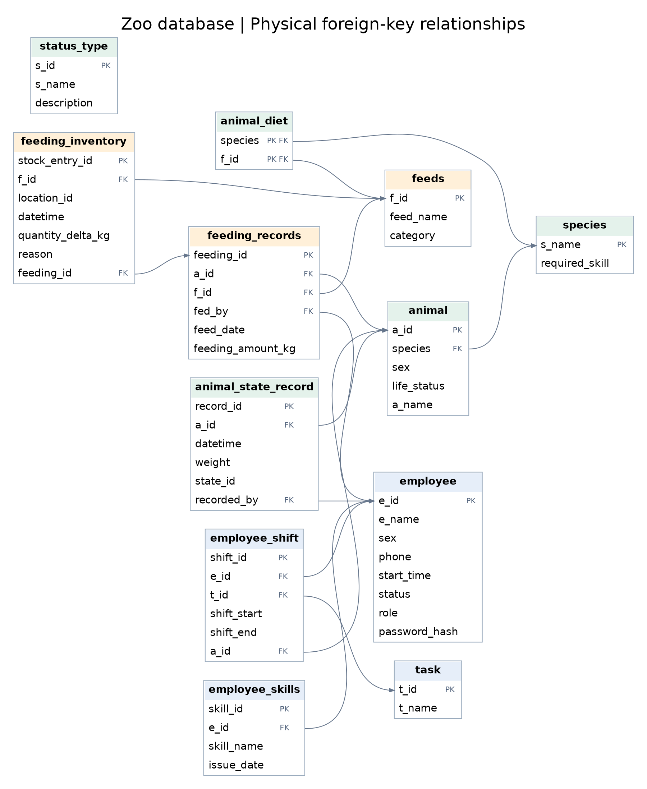
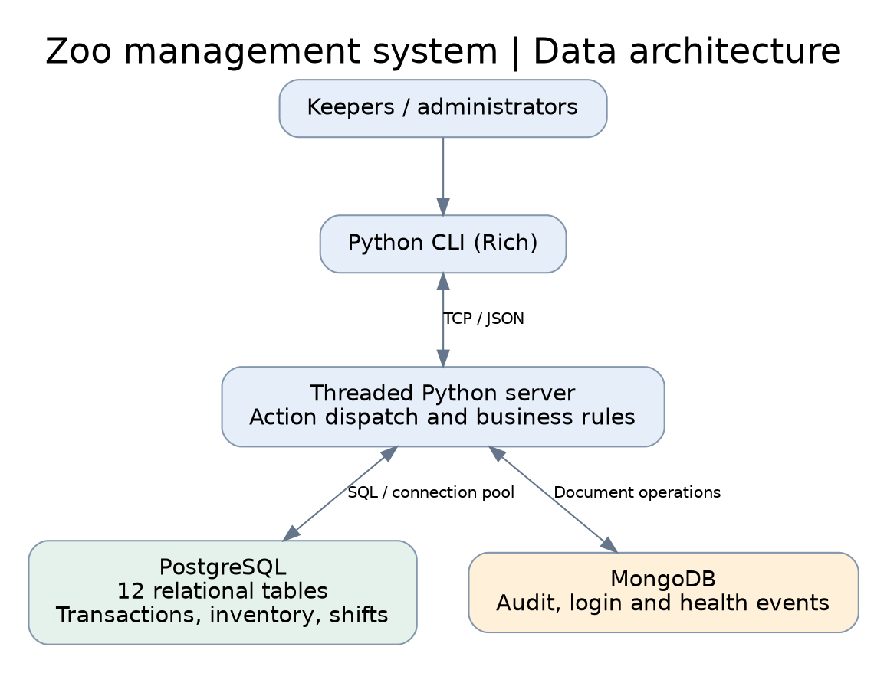
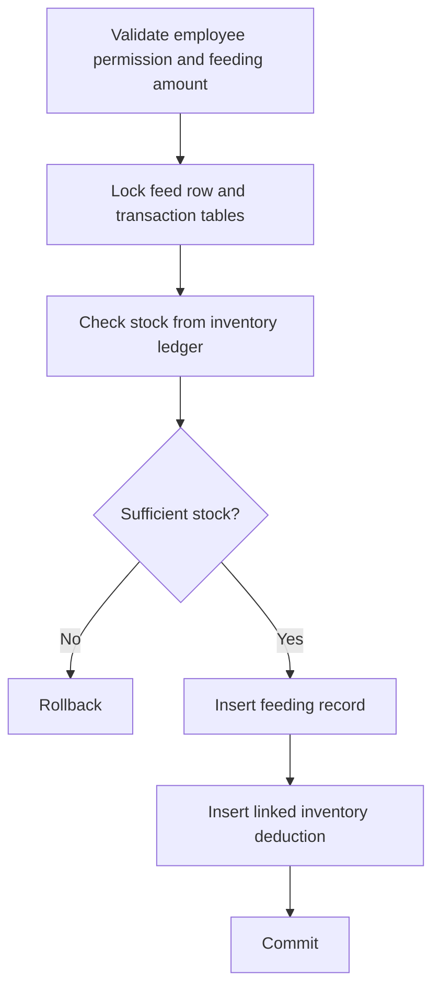
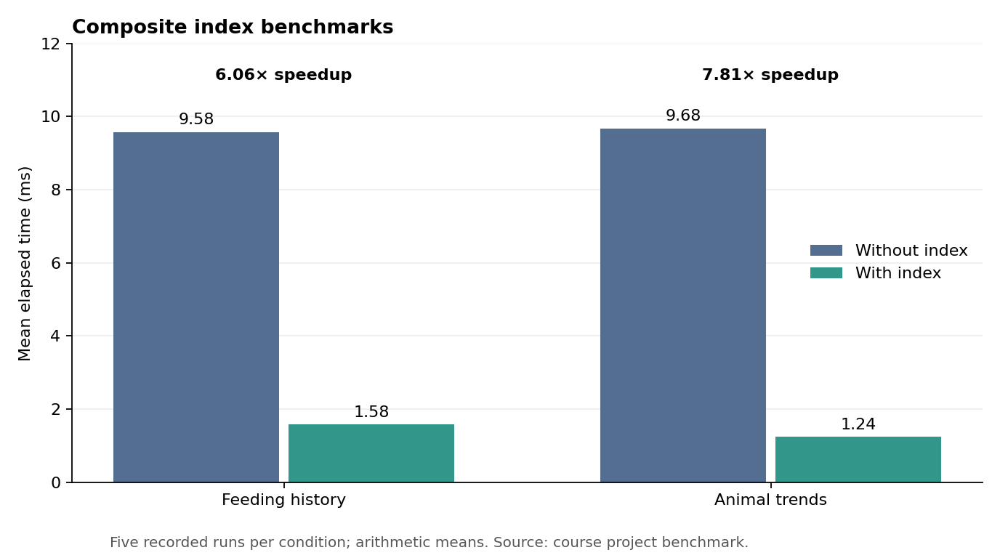

# Zoo Database Management System

**Database design · Synthetic data generation · SQL optimization · Transaction management**

A four-person team project for the Database Management course at National Taiwan University.

## Overview

Zoo operations require coordinated animal care, employee assignments, and inventory tracking. We developed a database-backed management system that connects feeding and health observations with personnel, species-specific care requirements, and feed inventory. The system uses PostgreSQL for relational transactions and MongoDB for event-oriented records. This portfolio focuses on the database engineering work; the [original team repository](https://github.com/pollop123/zoo_db) contains the complete Python client-server application and demonstration instructions.

## My Contributions

- Co-designed the relational schema, entity relationships, normalization, primary and foreign keys, and integrity constraints.
- Led synthetic data generation and database initialization, including linked feeding and inventory records, employee shifts, and species-specific health observations.
- Co-developed SQL queries supporting animal care, employee scheduling, and inventory management.
- Co-implemented transaction management and concurrency control mechanisms for coordinated feeding and inventory operations.
- Collaborated on the PostgreSQL and MongoDB architecture and discussed composite indexing, query optimization, and backend business logic.

My primary contributions focused on database construction, data generation, and transaction management. Application interfaces, anomaly detection, and system testing were developed by other team members. System and benchmark results are team-level outcomes.

## Database Design

The implemented schema includes 12 relational tables and 14 foreign-key constraints. Personnel, species, animal, and feed master records are separated from operational events and assignment rules. Junction tables represent species-specific diets and employee qualifications, while an inventory ledger links feed consumption to feeding records.



See [database design](docs/database_design.md), [SQL schema](sql/schema.sql), and [foreign-key inventory](results/foreign_keys.csv).

## Synthetic Data Generation

Six Python scripts generate seven CSV tables with 19,758 synthetic records. The pipeline models distinct entities, historical observations, and cross-table relationships rather than treating each dataset independently.

| Generated records | Rows |
|---|---:|
| Animals | 200 |
| Employees | 50 |
| Tasks | 8 |
| Employee shifts | 500 |
| Feeding records | 2,000 |
| Inventory movements | 2,000 |
| Animal health records | 15,000 |

Each simulated animal has a species-specific baseline weight; observations use Gaussian variation around that baseline. Feeding records generate matching negative inventory movements, and overnight shifts are handled across calendar dates. The [data generation documentation](docs/data_generation.md) explains the workflow.

The team's populated database snapshot contains **20,141 records**, including 15,019 health observations, across all 12 relational tables. See [database counts](results/database_summary.csv).

## Hybrid Database Architecture



PostgreSQL maintains operational records and referential integrity. MongoDB stores flexible audit, login, correction, and health-alert documents. A threaded Python server connects the databases to a role-based client interface. See [system architecture](docs/system_architecture.md).

## Transaction Management and Concurrency Control

Feeding and inventory changes are submitted together within one PostgreSQL transaction. A row-level lock on the feed master record serializes cooperating inventory writers; table locks protect the application's numeric identifier allocation. Insufficient stock triggers rollback rather than committing an incomplete feeding event.



See [transaction management](docs/transaction_management.md) for lock behavior and design trade-offs.

## Query Optimization

Two composite B-tree indexes support queries by animal identifier and descending event time. In the original course benchmarks, the two reported workloads achieved the following mean elapsed times over five runs per condition:

| Query | Without index | With index | Mean speedup |
|---|---:|---:|---:|
| Feeding history | 9.58 ms | 1.58 ms | 6.06× |
| Animal trends | 9.68 ms | 1.24 ms | 7.81× |



See [index definitions](sql/indexes.sql), [representative SQL queries](sql/analytical_queries.sql), and [benchmark methodology](docs/query_optimization.md).

## Key Findings and Operational Implications

- **Linked operational records support inventory traceability.** Coordinating feeding entries with inventory movements gives managers a consistent basis for tracking consumption and replenishment.
- **Workload-aware indexes improve access to historical observations.** Faster retrieval of recent feeding and health records can support routine monitoring and operational reporting.
- **Transaction boundaries protect coordinated updates.** Locking and rollback address conflicting inventory writes and reduce the risk of partially recorded feeding events.
- **Relational and document stores serve different data needs.** Structured master and transaction data remain in PostgreSQL, while flexible event records support audit and alert workflows in MongoDB.

Together, these design choices provide a data foundation for animal-care monitoring, staff coordination, and inventory planning.

## Running the Portfolio

Generate synthetic CSV files locally:

```bash
python -m pip install -r requirements.txt
python data_generation/run_all.py
python -m unittest discover -s tests
```

To create the relational schema in a new PostgreSQL 17 database:

```bash
createdb zoo_portfolio
psql -v ON_ERROR_STOP=1 -d zoo_portfolio -f sql/schema.sql
psql -v ON_ERROR_STOP=1 -d zoo_portfolio -f sql/indexes.sql
```

The generation scripts demonstrate the course's data construction methods; they are not a full seed for the final application schema. To run the complete application with its populated demonstration database, follow the [original team repository](https://github.com/pollop123/zoo_db). The recorded benchmark timings are historical course measurements, with the raw observations retained in [index_benchmark.csv](results/index_benchmark.csv).
