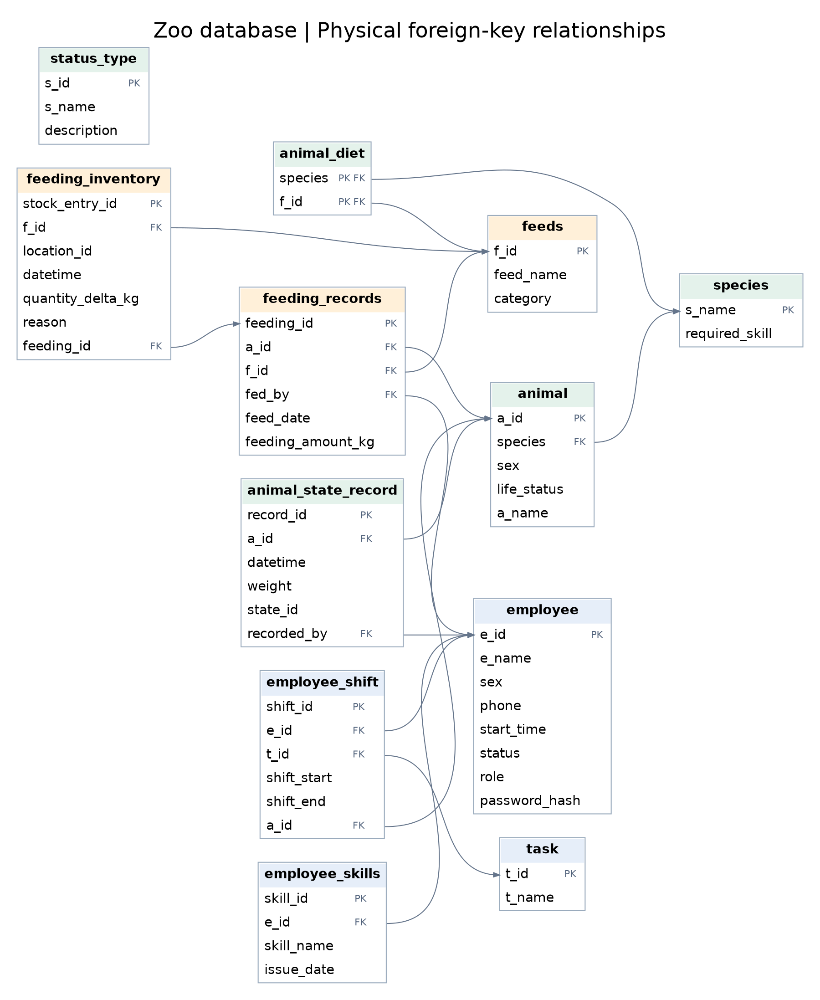

# Relational Database Design

The schema in [`sql/schema.sql`](../sql/schema.sql) represents the implemented PostgreSQL database. It includes 12 tables, 12 primary keys, 14 foreign keys, two additional unique constraints, and domain checks.

## Relation groups

| Table | Purpose | Primary key |
|---|---|---|
| employee | Personnel and application role | e_id |
| employee_skills | Employee qualifications | skill_id |
| employee_shift | Employee-task-animal assignments | shift_id |
| task | Task reference | t_id |
| animal | Individual animal master | a_id |
| species | Species and qualification requirement | s_name |
| animal_diet | Allowed feed per species | species, f_id |
| status_type | Health-state reference | s_id |
| animal_state_record | Timestamped health observations | record_id |
| feeds | Feed reference | f_id |
| feeding_records | Feeding events | feeding_id |
| feeding_inventory | Signed inventory ledger | stock_entry_id |

## Normalization and integrity

- Atomic fields keep individual observations and attributes separate.
- Species attributes are stored in `species`, rather than repeated for every animal. `animal_diet` represents the many-to-many relationship between species and feed types using a composite primary key.
- `employee_skills` separates multiple qualifications from employee master data. The `(e_id, skill_name)` unique constraint prevents duplicate qualification assignments.
- Feeding events, health observations and shifts reference their respective master records. Inventory movements can reference the feeding event responsible for consumption. Purchase movements do not require a feeding event.

These decompositions reduce redundancy and support reference integrity. The schema enforces the foreign keys recorded in [foreign_keys.csv](../results/foreign_keys.csv). `animal_state_record.state_id` is used as a health-status identifier in the application design, but the SQL schema does not declare a foreign key for that column. Business rules such as shift eligibility and stock sufficiency are handled by application logic.

Arrows in the diagram run from foreign-key columns to their referenced primary-key columns. The graph depicts declared database constraints, not every logical application relationship.
