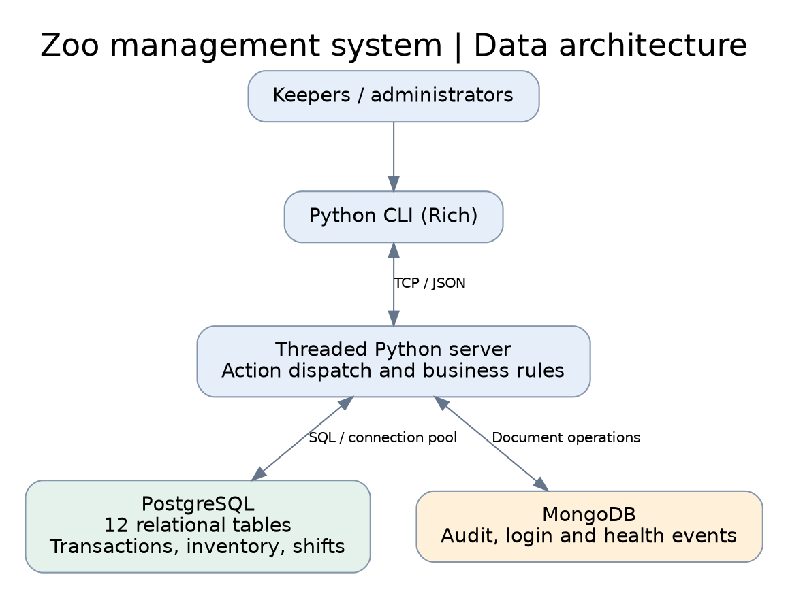

# System Architecture

The [team implementation](https://github.com/pollop123/zoo_db) uses a Python Rich CLI and threaded Python socket server. JSON messages are exchanged over TCP. Backend action handlers dispatch database and business operations through the service layer, which uses a PostgreSQL connection pool.

## Storage responsibilities

| Store | Responsibilities |
|---|---|
| PostgreSQL | Employee and animal master data, species, diets, qualifications, shifts, feeding records, inventory movements, health observations |
| MongoDB | Audit logs, health alerts, correction-related records and login events |

PostgreSQL is the source of truth for core operational data. MongoDB accommodates flexible event payloads and supports management queries for pending alerts and correction history. The stores do not participate in a single distributed transaction; core feeding and stock consistency is managed within PostgreSQL.

## Application workflows

Keepers enter feeding and health records and view their assignments. Administrators manage staffing, inventory and operational records. Application-level permission checks incorporate employee role, active shift, animal assignment and required qualifications. The full application is a course demonstration rather than a production deployment.
